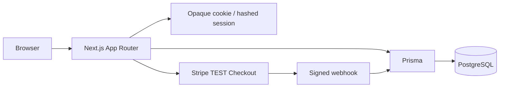
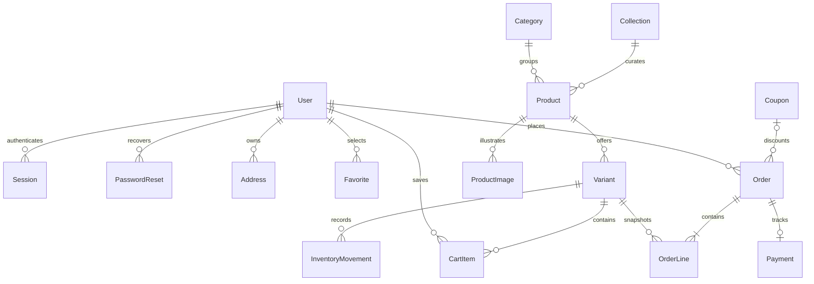

# Architecture

Next.js server components query Prisma directly for storefront data and protected account/admin views. Client components handle local state and progressive form interactions. Mutations use the App Router catch-all API with Zod schemas, session lookup, same-origin enforcement and server-side authorization. TanStack Query is deliberately unnecessary for these server-rendered reads.

## Data model

Setting stores tax and shipping configuration; Audit records successful administration mutations in the same transaction. RateLimit persists authentication/checkout counters; WebhookEvent enforces event deduplication. Unique indexes cover SKU, variant combination, email, session identifiers, checkout keys and Stripe sessions. SQL check constraints reject negative stock, invalid product prices and invalid quantities.

## Transaction boundaries

Checkout merges duplicate variants, validates quantities and active products, conditionally decrements stock in sorted variant order, records movements, resolves the coupon and snapshots totals inside a serializable transaction. Retryable conflicts are retried at most three times. A repeated checkout key returns the same owned order; another customer cannot reuse it. DEMO orders consume demo stock but are never marked paid.

Stripe sessions are created outside the database transaction using the order ID as Stripe idempotency key. Failure leaves a pending reservation for retry or reconciliation. A signed event must match the stored session, total, EUR currency and unpaid order state. An event ID is inserted atomically with its effect. Conditional cancellation transitions restore stock at most once. The reconciliation command checks Stripe before releasing old reservations. vercel.json prepares a daily protected maintenance invocation; it is inactive until authorized hosting is deployed. Card-only Test Checkout uses a stable per-order expiration time so retry parameters cannot drift.

## Identity and security decisions

Passwords use bcrypt cost 12. Session cookies contain 256-bit random tokens; only SHA-256 hashes are stored. Sessions expire after seven days. SameSite=Lax and strict Origin checks and bounded body reads protect JSON mutation endpoints. Atomic rate counters store hashed keys. Passwords are bounded to 72 UTF-8 bytes before bcrypt to reject silent truncation. HTTPS APP_URL enables Secure cookies. Authorization happens in the API before mutations; STAFF is limited to inventory and order operations; ADMIN can manage store resources. ALLOW_ADMIN_WRITES=false blocks all administrative mutations regardless of role.

Password reset delivery is local-test-only; production explicitly reports email delivery unavailable. The demo-login endpoint creates a random CUSTOMER identity per visitor. Browser state is cleared on logout or account changes and unsent edits are retried with a serialized synchronization queue. Quote and order totals are both calculated on the server. Administrator mutations are isolated in lib/admin.ts and checked again at the service boundary. Variants have an active flag, preserving inventory/order history when removed from the storefront. Address writes include user ownership in their update/delete predicate.

Password reset is a local test mechanism, not a production email system. Application error screens do not reveal database errors. Session renewal, MFA, email verification, advanced fraud/rate controls and production observability remain outside this first version.
